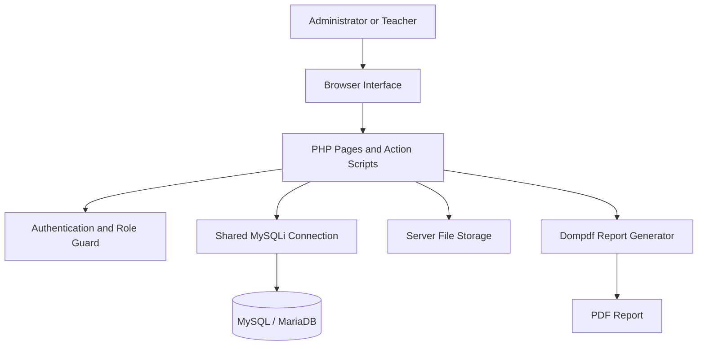

# EduSched — School Exam Scheduling System

EduSched is a web-based application developed for an **Information Systems Analysis and Design (APSI), Semester 3** course project. It is designed to help schools or tutoring organizations organize exam schedules, coordinate teacher activity, and manage question files associated with each schedule.

> **Project type:** Web application  
> **Project context:** Academic project — Semester 3  
> **Public showcase:** [EduSched-Showcase](https://github.com/SamuelPhe/EduSched-Showcase)

## 1. Application preview

Full application screenshots are not currently included in this repository. The existing image assets are branding and template resources, not verified screenshots of the running application.

Suggested screenshots to add:
- Login screen
- Administrator schedule management
- Teacher schedule and task view
- Activity history and PDF report

Use sample school, teacher, class, and schedule data. Do not upload real exam papers, student information, or private profile images.

## 2. Main features

- Login with **administrator** and **teacher** roles
- Exam schedule management by school, class, and subject
- Schedule dates, descriptions, and work-status tracking
- Question-file uploads associated with schedules
- User account management
- Activity history and change tracking
- Monthly activity summaries and PDF report export

## 3. Technology stack

- PHP (native)
- MySQL / MariaDB
- MySQLi
- HTML, CSS, and JavaScript
- Bootstrap
- Dompdf for PDF generation

## 4. Architecture overview

EduSched uses a page-oriented PHP application structure. Browser requests are handled by PHP pages and action scripts. The application connects to MySQL through a shared MySQLi connection, stores schedule and user records in the database, handles question-file uploads on the server, and uses Dompdf for PDF reports.



## 5. Demo and local setup

There is currently **no publicly hosted demo**. The application can be explored locally after preparing PHP and the database.

1. Install PHP with the `mysqli` and `fileinfo` extensions, plus MySQL or MariaDB.
2. Create a database named `edusched`.
3. Import [apsib/database/schema.sql](apsib/database/schema.sql).
4. Configure the database settings used by `apsib/koneksi.php` through environment variables or a local `apsib/.env` file:
   - `DB_HOST` (default: `127.0.0.1`)
   - `DB_PORT` (default: `3306`)
   - `DB_NAME` (default: `edusched`)
   - `DB_USER`
   - `DB_PASSWORD`
5. Start the PHP development server from the repository root:

   ```bash
   php -S 127.0.0.1:8000 -t apsib
   ```

6. Open `http://127.0.0.1:8000/login.php`.

The schema file contains table structure rather than real user data. Create a local administrator account before testing. No public demo credentials are provided.

## 6. Project structure

- `apsib/` — PHP application pages, scripts, styles, and assets
- `apsib/koneksi.php` — MySQLi database connection
- `apsib/auth_guard.php` — authenticated access and role checks
- `apsib/database/schema.sql` — database structure
- `apsib/dompdf/` — PDF generation library
- `apsib/lib/` — frontend libraries and assets

## 7. Copyright and license

Copyright (c) 2026 Samuel Phe. All rights reserved.

Original project code, documentation, and assets authored for EduSched are proprietary. No permission is granted to copy, modify, redistribute, sublicense, or reuse these materials without prior written permission. Bundled third-party libraries, including Dompdf and frontend packages, remain subject to their own licenses and notices. See the [LICENSE](LICENSE) file.

---

This is an academic portfolio project, not a production-ready school information system. Integration testing, comprehensive upload validation, CSRF coverage, and further SQL/security review are still required before use with real school data.
